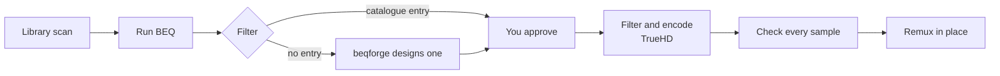

#  BEQ Encoder

[](https://github.com/RyanMelena/beq-encoder/actions/workflows/publish.yml)


**BEQ Encoder adds a bass-EQ (BEQ) copy of the best audio track of a film to the MKV of that film, as lossless TrueHD.**

It is a self-hosted web service.
The filter comes from the [BEQCatalogue](https://beqcatalogue.readthedocs.io/), or from the [beqforge](https://github.com/3ll3d00d/beqforge) designer when the catalogue has no entry for the track.
You approve every filter before the encoder touches a file.



## Why use it

- **Your processor treats the BEQ track like the original.** The track is TrueHD or TrueHD Atmos, so an AV processor decodes and upmixes it the same way.
- **Nothing changes except the BEQ.** The encoder compares every sample of the encoded track with the filtered source, and fails the job on a mismatch.
- **Atmos objects survive.** Every object keeps its audio and its position.
- **A failed job costs nothing.** The encoder replaces the source file only after every check passes.
- **The library looks after itself.** The encoder finds new films, flags the films that BEQ can help, and flags BEQ tracks that a newer filter supersedes.

## What gets a BEQ track

| Source track | BEQ track |
|---|---|
| TrueHD Atmos | TrueHD Atmos, every object kept |
| DD+ Atmos | TrueHD Atmos, objects decoded by [Cavern](https://github.com/VoidXH/Cavern) |
| TrueHD, DTS-HD MA, LPCM, FLAC | TrueHD |
| AC-3, DD+, DTS, AAC | TrueHD, with no second lossy encode |
| DTS:X | Refused. No available decoder outputs its objects. |
| Other layouts than 2.0, 5.1, and 7.1, or other rates than 48 kHz | Refused. |

The encoder never makes a lossy track and never drops the objects of an Atmos track.
A refused track ends as "unsupported" with the reason, and the encoder writes nothing.

## Quick start

You need three things:

- A Linux x86_64 host with Docker.
- A DEE folder, which you prepare once. The steps follow this list.
- Fast local disk for scratch files. An Atmos job needs about 8.3 GB for each hour of film.

### Prepare the DEE folder

The image does not contain the Dolby Encoding Engine (DEE). You supply it from your own licensed copy.
Dolby ships the TrueHD encoder of DEE 6.7, `dee_dthd_encoder`, for macOS only, so you convert that one program to Linux.

1. Get DEE 6.7 from Dolby in two packages: the Linux package and the macOS package.
2. Build the Linux `dee_dthd_encoder` from the macOS one. A one-off container in `tools/dee-build` does the conversion with [dthd-mac2linux](https://github.com/truehdd/dthd-mac2linux), and writes the result into the folder of the Linux package, beside `libmediainfo.so.0` and `license.lic`.

	```sh
	docker build -t beq-dee-build tools/dee-build
	docker run --rm \
		-v /path/to/macos-dee/dee_dthd_encoder:/in/dee_dthd_encoder:ro \
		-v /path/to/linux-dee:/out \
		beq-dee-build
	```

	The container is not part of the service. Delete its image afterwards with `docker image rm beq-dee-build`.
	If the folder already holds a `dee_dthd_encoder`, the container stops. Add `-e FORCE=1` to replace it.

`DEE_PATH` in `.env` is the path of that folder.
The encoder mounts the folder read-only, and the folder must not be on a `noexec` mount.

### Start the containers

Run these commands in the folder that holds `compose.yaml`:

```sh
cp .env.example .env    # set PUID, PGID, DEE_PATH, WORK_DIR, and MEDIA_DIR
. ./.env
mkdir -p config designer-cache designer-records "$WORK_DIR"
chown "$PUID:$PGID" config designer-cache designer-records "$WORK_DIR"
docker compose pull
docker compose up -d
```

Open `http://<host>:8080`. If the encoder cannot use your DEE folder, a banner at the top of the page says why.

> [!WARNING]
> The UI has no login and rewrites media files. Publish it only on a trusted network, or behind a reverse proxy that restricts access.

## Use it

1. Open a film from the **Library** page. The **BEQ candidates** view lists the films that BEQ can help.
2. Click **Run BEQ**. The encoder looks for a filter in the catalogue, then asks the designer.
3. Compare the candidates on the job page, pick one, and click **Approve & queue**.
4. Wait for the job. The film page then shows the BEQ track with its before and after charts.

## Documentation

| Page | Read it to |
|---|---|
| [How BEQ Encoder makes a BEQ track](docs/how-it-works.md) | Follow a job from **Run BEQ** to the replaced file. |
| [TrueHD encoding through dee_shim](docs/truehd-encoding.md) | Understand the DEE command and the checks that every encode must pass. |
| [DD+ Atmos through Cavern](docs/dd-plus-atmos.md) | Judge how far to trust a BEQ track made from DD+ Atmos. |
| [How the library stays current](docs/library.md) | Understand scans, the file watch, candidates, and stale BEQ tracks. |
| [What a job writes into the MKV](docs/output.md) | Look up the track name, the tags, the charts, and the attachments. |
| [Settings](docs/settings.md) | Look up an environment variable. |
| [How to build, release, and update BEQ Encoder](docs/maintaining.md) | Run the tests, build the image, release, and re-check a new DEE or dee_shim. |

## Known limits

- **Atmos position updates can play up to 32 ms early.** DEE moves each update to the start of its frame. See [how DEE codes object positions](docs/truehd-encoding.md#how-dee-codes-object-positions) and [dee-shim issue 3](https://github.com/truehdd/dee-shim/issues/3).
- **Nothing checks the downmixes that DEE derives.** A TrueHD Atmos stream also carries 7.1, 5.1, and stereo presentations for decoders without Atmos. The sync check reads them only above 300 Hz, where BEQ has no effect.
- **truehdd 0.6.2 reports `samplePos` with up to 32 samples of jitter.** The jitter changes neither the encode nor the position check.
- **You start every run from the UI.** No Radarr hook exists yet.

## Credits and licences

- [dee_shim](https://github.com/truehdd/dee-shim), Apache-2.0, runs the TrueHD encoder of DEE sample-exact. The image carries it with the patches in `docker/dee-shim/`. Its licence, its notices, and the patches are in `/usr/local/share/doc/dee-shim/` in the image.
- [truehdd](https://github.com/truehdd/truehdd) decodes TrueHD and TrueHD Atmos.
- [Cavern](https://github.com/VoidXH/Cavern) by VoidXH decodes DD+ Atmos objects. Its licence forbids selling it and asks for credit with a link. The terms are in [DD+ Atmos through Cavern](docs/dd-plus-atmos.md#build-the-image-without-cavern).
- [DEEW](https://github.com/pcrlnd/deew) first ran DEE 6.7 through dee_shim for TrueHD Atmos.
- The [BEQCatalogue](https://beqcatalogue.readthedocs.io/) supplies the filters, and [beqforge](https://github.com/3ll3d00d/beqforge) designs the rest.

The Dolby Encoding Engine belongs to Dolby. This project does not distribute it.
